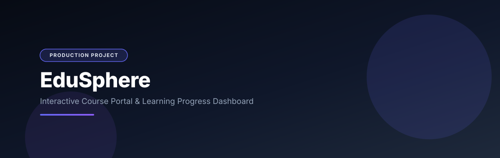
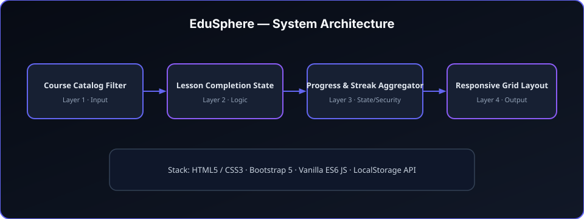
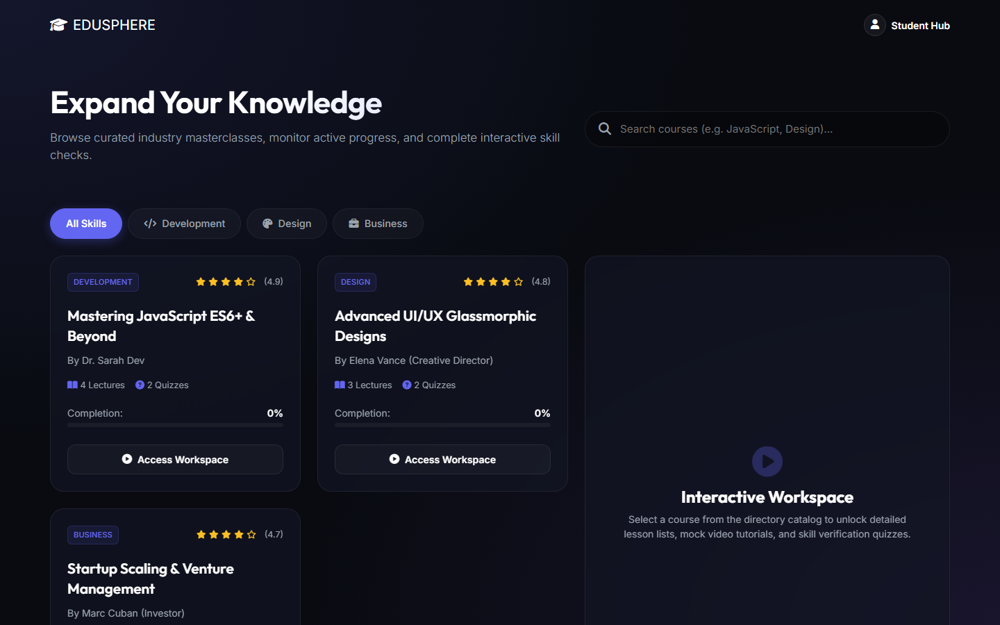

# EduSphere

> Interactive Course Portal & Learning Progress Dashboard

    



## 📌 Executive Overview
Modern online learning portal UI tracking enrolled courses, module completion checkboxes, study streaks, and dynamic category progress metrics.

---

## 🏛️ System Architecture



---

## 📷 Live Application Interface

Below is a genuine live capture rendered from the running local application:



---

## 🛠️ Tech Stack
- **HTML5 / CSS3**
- **Bootstrap 5**
- **Vanilla ES6 JS**
- **LocalStorage API**

---

## 🚀 How to Run

1. **Clone the repository:**
   ```bash
   git clone https://github.com/royalodi/edusphere.git
   cd edusphere
   ```

2. **Launch locally:**
   Open `index.html` directly or serve via any static HTTP server (`npx serve .`).

---

## 👨‍💻 Author & Lead Maintainer

<table>
  <tr>
    <td align="center" width="150" valign="middle">
      <a href="https://github.com/royalodi">
        
      </a>
      <br /><br />
      <b>Royal Odi</b><br />
      <sub><i>Full-Stack Engineer</i></sub>
    </td>
    <td valign="top">
      <p>
        Designed, engineered, and maintained by <b>Royal Odi</b>. Full-Stack Engineer focused on building scalable web architectures, robust backend systems, and responsive, high-performance digital experiences.
      </p>
      <p>
        <a href="https://github.com/royalodi"></a>
        <a href="mailto:royalodi.dev@gmail.com"></a>
        <a href="https://github.com/royalodi?tab=repositories"></a>
      </p>
    </td>
  </tr>
</table>

---

## 📄 License
Distributed under the **MIT License**.
